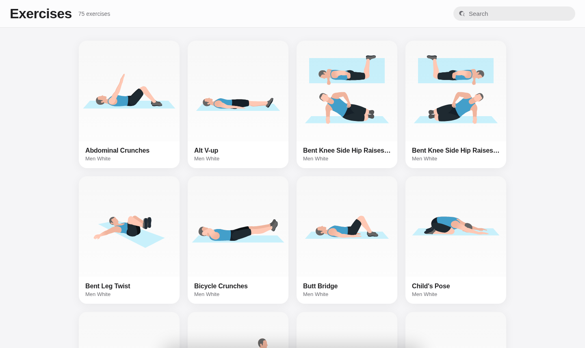

# Open Exercises

> **75 animated exercises. Zero setup. Straight in your browser.**

[](LICENSE)
[]()
[](https://airbnb.io/lottie/)

Open Exercises is a fast, dependency-free web app that shows you **how** to do an exercise with a looping animation before you do it. It ships **75 bodyweight exercises** as [Lottie](https://airbnb.io/lottie/) animations, rendered live in your browser — no install, no account, no CDN, and no build step.

**Who is it for?** Anyone working out at home or in the gym who wants a quick, reliable visual reference: pick an exercise, watch the movement, read the numbered steps. It runs on any modern browser, works on phone and desktop, and looks right in light and dark mode.

## Screenshot

A live capture of the app running locally (light theme, `?theme=light`):



Force a theme for screenshots with `?theme=light` or `?theme=dark` (default follows your system setting).

## Features

- **75 exercises with looping Lottie animations** — the movement itself, not a still photo
- **Smart previews** — card thumbnails only start animating when they scroll into view (via `IntersectionObserver`) and pause when off-screen, so a big grid stays smooth
- **Instant search** — filters live by exercise name or description, with an empty state and result count
- **Detail sheet** — tap a card for the full-size animation plus the exercise's numbered step-by-step instructions; closes with Esc, the ✕ button, or the backdrop
- **Light & dark themes** — automatic via `prefers-color-scheme`, overridable with `?theme=light|dark`
- **Respects `prefers-reduced-motion`** for users who opt out of motion
- **Zero npm dependencies** — the lottie-web player is bundled, and the dev server is a few dozen lines of Node standard library
- **Data-driven** — the whole app is driven by one JSON catalog; adding an exercise is a JSON file plus one catalog line (see below)

## Quick start

All you need is [Node.js](https://nodejs.org/) (18+). There is nothing to `npm install`.

```sh
git clone https://github.com/badboysm890/open-exercises-app.git
cd open-exercises-app

node app/server.js
# → Open Exercises running at http://localhost:8765
```

Then open the printed URL (or `http://localhost:8765`). Use a custom port with the `PORT` env var:

```sh
PORT=8899 node app/server.js
```

Any static file server that serves the repo root works too — the app only needs `/index.html`, the files in `app/`, and the `/data/...` JSON over HTTP.

## Project structure

```
open-exercises-app/
├── app/
│   ├── index.html      # Page: sticky header, search, exercise grid, detail sheet
│   ├── app.js          # Grid, live search, lazy Lottie previews, sheet logic
│   ├── style.css       # Apple-style light/dark theme, spring sheet easing
│   ├── lottie.min.js   # Bundled lottie-web player — works offline, no CDN
│   └── server.js       # Dependency-free Node static server (Node standard library)
├── data/
│   ├── catalog.json    # The exercise catalog: id, name, instructions, skin, file
│   └── exercises/      # 75 Lottie (bodymovin) JSON animations
├── docs/
│   └── screenshot.png  # Screenshot used in this README
├── LICENSE
└── README.md
```

## How the exercise data works

The app is a thin, generic renderer over a data catalog:

- **`data/catalog.json`** is an array of exercise entries:
  ```json
  {
    "id": "0",
    "name": "ABDOMINAL CRUNCHES",
    "introduce": "Lie on your back…\\n\\nLift your upper body…\\n\\nIt primarily works the rectus abdominis…",
    "skin": "men_white",
    "file": "exercises/ex_0.json"
  }
  ```
  - `name` is stored in UPPER_CASE and displayed Title Cased.
  - `introduce` is plain text whose `\n` escapes are split into the numbered instruction lines in the detail sheet.
  - `file` points at the Lottie animation under `data/exercises/`.
  - `skin` labels the character variant of the animation (currently the catalog ships the `men_white` skin, displayed as "Men White").
- **`data/exercises/*.json`** are standard Lottie (bodymovin) documents (480×420 @ 24 fps).
- On startup the app fetches the catalog once and renders the grid. Each card's preview fetches its animation **lazily** on first scroll-in, keeps a per-file animation cache so the same movement is never fetched twice, and pauses the loop whenever the card leaves the viewport. The detail sheet reuses that cache and renders at full size with the SVG renderer.

Because everything is static JSON over HTTP, the app works fully offline once the files are local.

## Adding a new exercise

1. Add the Lottie animation file to `data/exercises/` (e.g. `ex_99.json`). Any bodymovin JSON exported from After Effects / bodybuilder works.
2. Append an entry to `data/catalog.json`:
   ```json
   {
     "id": "99",
     "name": "MY NEW EXERCISE",
     "introduce": "Start from a plank position.\\n\\nLower your body slowly.\\n\\nIt primarily works the core.",
     "skin": "men_white",
     "file": "exercises/ex_99.json"
   }
   ```
   Keep `name` in UPPER_CASE and write one sentence per numbered step, separated by `\\n\\n`.
3. Refresh the page — there is no build step and no server restart needed.

New character variants (skins) work the same way: ship the matching animation files and reference a new `skin` value; the label is the value with underscores turned into spaces.

## Tech stack

- **Vanilla HTML, CSS, and JavaScript** — no framework, no build step, no transpilation
- **[lottie-web](https://airbnb.io/lottie/)** (MIT) — the animation player, bundled as `app/lottie.min.js`
- **Node.js standard library** — the bundled static server uses only `node:http` and `node:fs/promises`
- **Modern web APIs** — `IntersectionObserver` for lazy previews, CSS `prefers-color-scheme` / `prefers-reduced-motion`

## Contributing

Contributions are welcome! The project intentionally has **no dependencies and no build step**, so please keep it that way.

1. Fork the repo and create a feature branch (`git checkout -b my-improvement`).
2. Make your change and run `node app/server.js` to verify it in the browser — check light **and** dark mode, search, and the detail sheet.
3. For UI changes, attach a screenshot in the PR (`?theme=light` / `?theme=dark`).
4. Exercise data additions follow the [adding a new exercise](#adding-a-new-exercise) steps above.
5. Open a pull request describing what changed and why.

## License

Released under the [MIT License](LICENSE).

## Credits

- **[lottie-web](https://airbnb.io/lottie/)** by [bodymovin](https://github.com/airbnb/lottie-web) (MIT) — the animation player, bundled as `app/lottie.min.js`.
- **Exercise animations** — Lottie (bodymovin) JSON documents derived from the *sixpack-lottie* project, a small library for showing the same workout animation assets in fitness apps; the animation files ship in `data/exercises/`.
